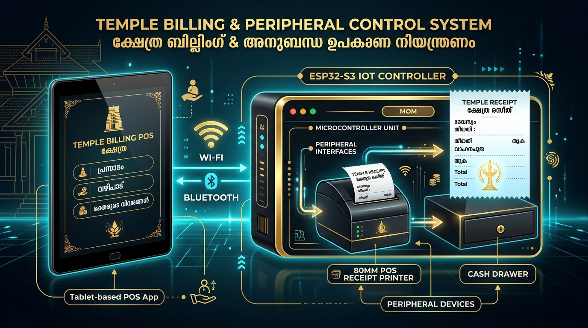
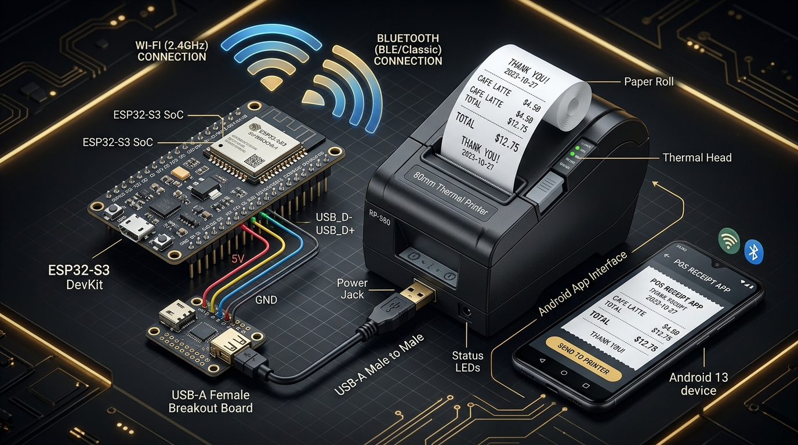

# ESP32-S3 Wireless Thermal Receipt Printer Bridge (Wi-Fi + BLE)

[](https://opensource.org/licenses/MIT)
[-red.svg)](https://www.espressif.com/)
[](https://en.wikipedia.org/wiki/ESC/P)
[](https://android.com)

Turn any wired **USB POS-80 (80mm / 3 inch)** or **POS-58 (58mm / 2 inch)** thermal receipt printer into a high-performance **Wireless Wi-Fi & Bluetooth (BLE) Smart Printer** using an **ESP32-S3** microcontroller with native hardware USB Host.

---

## 📸 System Overview



This project allows Android smartphones, tablets, laptops, and web billing applications (like **TempleERP**) to print receipts wirelessly without running long USB cables or keeping a heavy PC turned on all day.

---

## ✨ Key Features

- **Native USB Host (No External Shield Needed):** Directly connects to the printer's USB cable using the ESP32-S3's hardware USB OTG controller.
- **Dual Wireless Modes:**
  - **Wi-Fi Mode:** Runs a RAW JetDirect TCP Server on **Port 9100** + Web Dashboard with **HTTP REST API** (`POST /api/print`).
  - **Bluetooth Low Energy (BLE):** Emulates Nordic UART Service (NUS) for direct pairing with mobile receipt apps like **RawBT**.
- **Auto-Cutter Support:** Automatically triggers full/partial paper cuts (`GS V 'B' 0`) after receipt printing.
- **Cash Drawer Kick:** Supports RJ11/RJ12 electronic cash drawer pulse triggering (`ESC p`).
- **Malayalam & Multi-Language Typography:** Supports high-resolution bitmap raster printing (`GS v 0`) for perfect regional script rendering (മലയാളം അക്ഷരങ്ങൾ & ചിഹ്നങ്ങൾ).
- **Web Dashboard:** Access `http://<esp32-ip>/` from any phone browser to view printer status, Wi-Fi signal, and print diagnostic test receipts.

---

## 🔌 Hardware Wiring & Pinout



### Required Components:
1. **ESP32-S3 Development Board** (Recommended: *ESP32-S3-DevKitC-1 N8R8* or *N16R8* with 8MB/16MB Flash and 8MB PSRAM).
2. **USB-A Female Breakout Board** (or standard 4-wire USB-A female pigtail cable).
3. **5V 2A DC Power Supply** (or micro-USB / Type-C 5V adapter).
4. **POS-80 or POS-58 USB Thermal Printer** (with standard 24V power adapter and USB cable).

### Pin Connection Table:

| ESP32-S3 Pin | USB-A Female Breakout | Function | Standard Wire Color |
| :--- | :--- | :--- | :--- |
| **GPIO 19** | **D-** | USB Data Minus | **White** |
| **GPIO 20** | **D+** | USB Data Plus | **Green** |
| **5V / VBUS** | **VBUS (5V)** | 5V Power for USB | **Red** |
| **GND** | **GND** | Ground | **Black** |

> [!IMPORTANT]
> Make sure both the ESP32-S3 and the USB-A breakout share a common ground (**GND**).

---

## ⚡ How to Flash the Firmware

### Option A: Using Arduino IDE (Beginner Friendly)

1. Open **Arduino IDE** (version 2.x recommended).
2. Go to **File ➔ Preferences** and add the ESP32 Board URL:
   ```
   https://raw.githubusercontent.com/espressif/arduino-esp32/gh-pages/package_esp32_index.json
   ```
3. Go to **Tools ➔ Board ➔ Boards Manager**, search for `esp32` by Espressif Systems, and click **Install**.
4. Open the sketch:
   `examples/arduino_ide/esp32_pos80_bridge/esp32_pos80_bridge.ino`
5. Configure your Tools menu:
   - **Board:** `ESP32S3 Dev Module`
   - **USB Mode:** `Hardware CDC and JTAG`
   - **USB CDC On Boot:** `Enabled`
   - **Flash Size:** `8MB (64Mb)` or `16MB`
   - **PSRAM:** `OPI PSRAM`
6. Edit your Wi-Fi details at the top of the sketch:
   ```cpp
   const char* WIFI_SSID     = "YOUR_WIFI_NAME";
   const char* WIFI_PASSWORD = "YOUR_WIFI_PASSWORD";
   ```
7. Click **Upload**!

### Option B: Using PlatformIO (VS Code)

1. Clone this repository:
   ```bash
   git clone https://github.com/Babuperumana/esp32-pos80-thermal-printer.git
   cd esp32-pos80-thermal-printer
   ```
2. Open the folder in VS Code with PlatformIO extension installed.
3. Edit Wi-Fi credentials in `src/main.cpp`.
4. Run:
   ```bash
   pio run --target upload
   ```

---

## 📱 How to Print from Android

### Method 1: Bluetooth Printing via RawBT (No Router Needed)

1. Install **[RawBT Print Service](https://play.google.com/store/apps/details?id=ru.a402d.rawbtprint)** from Google Play Store.
2. Turn on Bluetooth on your Android phone.
3. Open RawBT ➔ **Settings ➔ Connection**.
4. Choose **Bluetooth** ➔ Tap Search ➔ Select **`POS-80-Wireless`**.
5. Set Paper Width to **80mm** (or 58mm).
6. Tap **Test Print** — the receipt will print and cut instantly!

### Method 2: Wi-Fi RAW Port 9100 (Instant Network Printing)

1. Connect your Android phone to the same Wi-Fi network as the ESP32.
2. In RawBT or your custom POS billing software, choose **Network / TCP**.
3. Enter the ESP32 IP address (e.g. `192.168.1.150`) and Port: `9100`.
4. Tap Print!

### Method 3: Direct Web REST API (For Web Billing Apps & TempleERP)

Any web browser running on mobile or tablet can send print commands directly to the ESP32 via HTTP POST:

```javascript
// Example JavaScript fetch call from TempleERP / Web App
fetch('http://192.168.1.150/api/print', {
    method: 'POST',
    headers: { 'Content-Type': 'text/plain' },
    body: "പരമ്പത്ത്കാവ് ഭഗവതി ക്ഷേത്രം\nരസീത് നമ്പർ: BL-2026-0042\nവഴിപാട്: പുഷ്പാഞ്ജലി (x1) - ₹50\nആകെ തുക: ₹50\n"
})
.then(res => res.json())
.then(data => console.log('Print sent!', data));
```

---

## 🇮🇳 മലയാളത്തിലുള്ള നിർദ്ദേശങ്ങൾ (Malayalam Guide)

### ഈ പ്രോജക്റ്റ് എന്തിനാണ്?
ക്ഷേത്രങ്ങളിലോ കടകളിലോ കമ്പ്യൂട്ടറും വലിയ വയറുകളും ഇല്ലാതെ തന്നെ, ജീവനക്കാരുടെ **ആൻഡ്രോയിഡ് മൊബൈൽ ഫോണിൽ നിന്നും ടാബ്‌ലെറ്റിൽ നിന്നും** നേരിട്ട് തെർമൽ പ്രിന്ററിലേക്ക് വയർലെസ് ആയി വഴിപാട് രസീതുകൾ പ്രിന്റ് ചെയ്യാൻ ഈ പ്രോജക്റ്റ് സഹായിക്കുന്നു.

### ഘട്ടങ്ങൾ:
1. ഒരു **ESP32-S3** ബോർഡ് എടുക്കുക.
2. ചിത്രത്തിൽ കാണിച്ചിരിക്കുന്നതുപോലെ (Wiring Diagram), ഒരു USB-A ഫീമെയിൽ സോക്കറ്റ് ESP32-S3 യുടെ **GPIO 19 (White)**, **GPIO 20 (Green)**, **5V (Red)**, **GND (Black)** പിന്നുകളിലേക്ക് ഘടിപ്പിക്കുക.
3. പ്രിന്ററിന്റെ USB കേബിൾ ഈ സോക്കറ്റിലേക്ക് കുത്തുക.
4. കമ്പ്യൂട്ടറിൽ Arduino IDE തുറന്ന് ഈ പ്രോജക്റ്റിലെ കോഡ് ESP32-ലേക്ക് ഫ്ലാഷ് ചെയ്യുക.
5. ആൻഡ്രോയിഡ് ഫോണിൽ **RawBT** ആപ്പ് വഴി ബ്ലൂടൂത്ത് സെർച്ച് ചെയ്താൽ `POS-80-Wireless` എന്ന് കാണാം.
6. ഇനി മൊബൈലിൽ നിന്ന് പ്രിന്റ് കൊടുത്താൽ കൗണ്ടറിലുള്ള പ്രിന്ററിലൂടെ രസീത് ഭംഗിയായി പ്രിന്റായി വരും!

---

## 📜 License
MIT License. Free for temples, retail businesses, and open-source ERP integrations.
